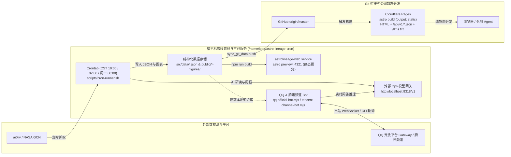

# AstroLineage 系统架构总览

> 关联文档：[架构与系统蓝图 (`ARCHITECTURE.md`)](../ARCHITECTURE.md) ｜ [服务拓扑与运维手册](runbooks/service-topology-and-operations.md) ｜ [定时任务调度指南](scheduled-tasks-guide.md)

---

## 一、一句话结论

**不是传统意义上的“前后端分离（SPA + 运行时后端 API 服务器）”。**

更准确的说法是：**“离线批处理生成数据 + Git 驱动纯静态站点构建（SSG）+ 独立外连式本机常驻 Bot”架构**：

- **Web 站点本身是纯静态的、无运行时后端**：前端页面与所有 `/api/v1/*.json`、`/llms.txt`、`/openapi.yaml` 接口均在构建期由 Astro 预渲染为静态文件，部署至 Cloudflare Pages（及校内静态预览 `:4321`）；浏览器端没有任何运行时 SSR、Pages Functions 或后端 API 请求。
- **“后端能力”被拆分为离线管线与独立 Bot 进程**：文献抓取、AI 研读与周报生成由本机 Crontab 定时离线跑完并写入 `src/data/`，通过 `git push` 衔接静态站重建；实时学术问答由本机常驻的 QQ / 腾讯频道 Bot 主动外连腾讯平台提供，不对外暴露 HTTP API，也不与 Web 前端直连。

---

## 二、与“纯静态、无后端服务器”假设的核对结果

经核查全仓代码与配置，Web 站侧**未发现**任何 SSR 路由、Cloudflare Pages Functions 或运行时 API 服务器；但宿主机上存在**非纯静态资产的常驻/定时进程**，边界如下：

| 核查项                         | 实际情况                                                               | 结论                                                                             | 依据文件                                                                                                                                                                                              |
| :----------------------------- | :--------------------------------------------------------------------- | :------------------------------------------------------------------------------- | :---------------------------------------------------------------------------------------------------------------------------------------------------------------------------------------------------- |
| Astro 渲染模式                 | `output: "static"`，未配置任何 SSR adapter，全站无 `prerender = false` | 纯静态构建（SSG）                                                                | [`astro.config.mjs`](../astro.config.mjs)、[`package.json`](../package.json)                                                                                                                          |
| Cloudflare Pages Functions     | 仓库中无 `functions/` 目录，无 `wrangler.toml`                         | 无服务端函数                                                                     | 仓库根目录及 `.github/workflows/`                                                                                                                                                                     |
| 前端运行时 API 调用            | `src/` 下无 `fetch(`、`EventSource`、`WebSocket` 客户端调用            | 无浏览器端后端依赖                                                               | [`src/pages/`](../src/pages/)、[`src/components/`](../src/components/)                                                                                                                                |
| `/api/v1/*.json` 与 `llms.txt` | 均为 Astro 静态端点，在 `astro build` 期间一次性生成静态文件           | 构建期静态产物（非运行时 API）                                                   | [`src/pages/api/v1/daily.json.ts`](../src/pages/api/v1/daily.json.ts)、[`src/pages/llms.txt.ts`](../src/pages/llms.txt.ts)、[`src/pages/openapi.yaml.ts`](../src/pages/openapi.yaml.ts)               |
| 本机预览服务 `:4321`           | 运行 `astro preview --host 0.0.0.0 --port 4321`                        | 仅提供静态文件 HTTP 预览，无动态计算                                             | [`deploy/systemd/astrolineage-web.service`](../deploy/systemd/astrolineage-web.service)                                                                                                               |
| QQ / 腾讯频道 Bot              | 通过 WebSocket 客户端外连 `wss://api.sgroup.qq.com` 或定时轮询 CLI     | 纯出站长连接/轮询，**不监听 HTTP 端口、无对外 Webhook/API**                      | [`scripts/qq-official-bot.mjs`](../scripts/qq-official-bot.mjs)、[`scripts/tencent-channel-bot.mjs`](../scripts/tencent-channel-bot.mjs)                                                              |
| 本地模型网关 `:8318`           | 监听 `http://localhost:8318/v1` 的 OpenAI 兼容代理                     | **非静态后端服务**，但归外部 ops 运维管理，不在本仓库内，仅供本机脚本与 Bot 调用 | [`scripts/agent-core.mjs`](../scripts/agent-core.mjs)、[`scripts/arxiv-ai-analyzer.mjs`](../scripts/arxiv-ai-analyzer.mjs)、[`scripts/arxiv-weekly-summary.mjs`](../scripts/arxiv-weekly-summary.mjs) |

---

## 三、核心组件清单

### 1. 静态站（Web 展现层）

- **输出模式**：Astro 6 配置为 `output: "static"`，构建命令 `npm run build` 依次执行图谱校验（`npm run validate`）、索引生成（`node scripts/editorial-index.mjs`）与 `astro build`，输出全量静态产物至 `dist/`。
  - 依据：[`astro.config.mjs`](../astro.config.mjs)、[`package.json`](../package.json)
- **Cloudflare Pages 构建与 `PUBLIC_SITE_URL`**：
  - 默认公网基址为 `https://astro-lineage.pages.dev`（`DEFAULT_PUBLIC_SITE_URL`）。
  - 构建与外发链接解析优先级：`PUBLIC_SITE_URL` / `ASTRO_SITE_URL` 环境变量 → Cloudflare Pages 构建环境检测（`CF_PAGES=1` 或 `CF_PAGES=true` 时回退至 `DEFAULT_PUBLIC_SITE_URL`）→ `LOCAL_SITE_URL` → 校内默认地址 `http://10.131.43.83:4321`。
  - 依据：[`src/domain/academic-domain.mjs`](../src/domain/academic-domain.mjs)、[`src/domain/agent-egress.mjs`](../src/domain/agent-egress.mjs)

### 2. 数据生成层（离线批处理管线）

- **统一调度入口**：[`scripts/cron-runner.sh`](../scripts/cron-runner.sh)，支持 `auto`、`daily`、`weekly`、`reconcile`、`group-weekly`、`build` 等模式，通过 `.cache/cron-runner.lock`（`flock`）保证宿主机单实例互斥执行。
- **调度时间（北京时间 `CRON_TZ=Asia/Shanghai`）**：
  - **周一至周五 10:00**：执行 `cron-runner.sh auto`（抓取当日 arXiv、AI 研读、GCN 事件追踪、重建静态站、同步频道并推送 Git 数据；周五追加周报生成）。
  - **周二至周六 02:00**：执行 `cron-runner.sh reconcile`（前日兜底扫描与连续区间对账封板）。
  - **每周一 08:00**：执行 `cron-runner.sh group-weekly`（向授权 QQ 群广播上一学术周周报）。
  - 依据：[`deploy/crontab.txt`](../deploy/crontab.txt)、[`scripts/cron-runner.sh`](../scripts/cron-runner.sh)
- **模型网关**：批处理脚本（[`scripts/arxiv-ai-analyzer.mjs`](../scripts/arxiv-ai-analyzer.mjs)、[`scripts/arxiv-weekly-summary.mjs`](../scripts/arxiv-weekly-summary.mjs)）默认将请求路由至 `http://localhost:8318/v1`（当 `OPENAI_BASE_URL` 未配置或指向已弃用旧地址时自动回退）。

### 3. 数据存储与 Git 衔接层

- **核心结构化数据（`src/data/`）**：
  - `src/data/arxiv-daily.json`：当前批次抓取的 arXiv 原始条目。
  - `src/data/daily-radar.json`：当前活跃批次的 AI 研读雷达数据。
  - `src/data/arxiv-weekly.json`：当周学术脉络周报数据。
  - `src/data/scientific-events.json` 与 `src/data/gcn-events/`：GCN 瞬变源事件与多波段光变数据。
  - `src/data/paper-translations.json`：论文标题中文译名静态映射表。
  - `src/data/arxiv-archives/`：按日/按周沉淀的历史归档快照。
  - 依据：[`ARCHITECTURE.md`](../ARCHITECTURE.md)、[`src/data/`](../src/data/)
- **Git 衔接机制**：`cron-runner.sh` 在 `CRON_GIT_PUSH=true` 且工作区仅包含 `src/data/`、`public/arxiv-weekly/`、`public/gcn-figures/` 改动时，调用 `sync_git_data` 自动提交并推送到远程 `master`，进而触发 Cloudflare Pages 重新构建静态站。同时通过 [`scripts/sync-recent-figures.mjs`](../scripts/sync-recent-figures.mjs) 仅将最近 7 周图表纳入 Git 跟踪以控制仓库体积。
  - 依据：[`scripts/cron-runner.sh`](../scripts/cron-runner.sh)、[`ARCHITECTURE.md`](../ARCHITECTURE.md)

### 4. 对外接口（全部为构建期静态生成）

以下路由均位于 `src/pages/`，在 `astro build` 时由 `APIRoute` 静态求值并输出为静态文件，**不存在任何运行时动态响应**：

- [`src/pages/api/v1/daily.json.ts`](../src/pages/api/v1/daily.json.ts) → `/api/v1/daily.json`（注：其中 `generated_at` 为构建时刻时间戳）
- [`src/pages/api/v1/weekly.json.ts`](../src/pages/api/v1/weekly.json.ts) → `/api/v1/weekly.json`
- [`src/pages/api/v1/events.json.ts`](../src/pages/api/v1/events.json.ts) → `/api/v1/events.json`
- [`src/pages/llms.txt.ts`](../src/pages/llms.txt.ts) → `/llms.txt`
- [`src/pages/llms-full.txt.ts`](../src/pages/llms-full.txt.ts) → `/llms-full.txt`
- [`src/pages/openapi.yaml.ts`](../src/pages/openapi.yaml.ts) → `/openapi.yaml`
- [`src/pages/agent.astro`](../src/pages/agent.astro) → `/agent/`（Agent 接入说明静态页）

### 5. 本机常驻服务（Systemd User 与外部 Ops）

宿主机生产目录为 `/home/long/astro-lineage-cron`（常驻 `master` 分支，与开发目录 `/home/long/astro-lineage` 隔离）：

| 服务 / 进程                   | 管理方式      | 监听 / 连接方式                               | 职责                                               | 依据文件                                                                                                                                                                                   |
| :---------------------------- | :------------ | :-------------------------------------------- | :------------------------------------------------- | :----------------------------------------------------------------------------------------------------------------------------------------------------------------------------------------- |
| `astrolineage-web.service`    | Systemd User  | 监听 `0.0.0.0:4321`（`astro preview`）        | 校内局域网静态预览（`http://10.131.43.83:4321`）   | [`deploy/systemd/astrolineage-web.service`](../deploy/systemd/astrolineage-web.service)、[`docs/runbooks/service-topology-and-operations.md`](runbooks/service-topology-and-operations.md) |
| `astrolineage-qq-bot.service` | Systemd User  | 纯出站 WebSocket（`wss://api.sgroup.qq.com`） | QQ 群、频道、私聊实时问答（调用 `agent-core.mjs`） | [`deploy/systemd/astrolineage-qq-bot.service`](../deploy/systemd/astrolineage-qq-bot.service)、[`scripts/qq-official-bot.mjs`](../scripts/qq-official-bot.mjs)                             |
| `astrolineage-bot.service`    | Systemd User  | 纯出站 CLI 轮询（`--interval=30`）            | 腾讯频道论坛版块帖子与评论巡检互动                 | [`deploy/systemd/astrolineage-bot.service`](../deploy/systemd/astrolineage-bot.service)、[`scripts/tencent-channel-bot.mjs`](../scripts/tencent-channel-bot.mjs)                           |
| 模型网关 (`:8318`)            | 外部 Ops 运维 | 本机监听 `localhost:8318/v1`                  | 为离线分析脚本与实时 Bot 提供 OpenAI 兼容模型代理  | [`scripts/agent-core.mjs`](../scripts/agent-core.mjs)、[`scripts/probe-models.mjs`](../scripts/probe-models.mjs)                                                                           |

---

## 四、系统数据流图

